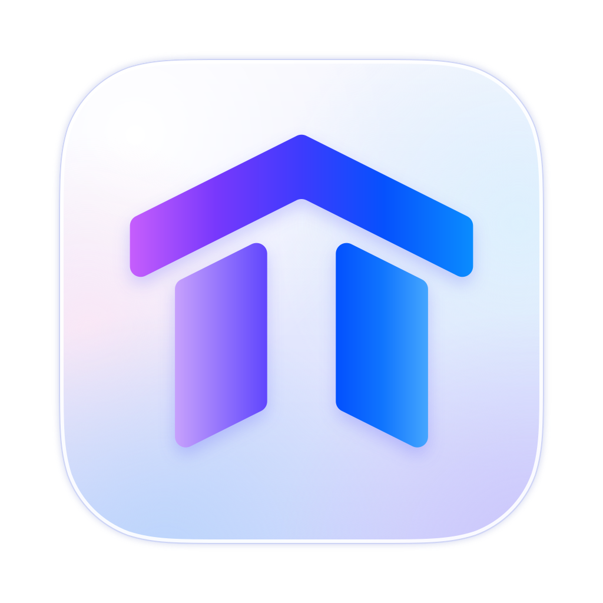

<p align="center">
  <picture>
    <source media="(prefers-color-scheme: dark)" srcset="crates/templum/icons/icon-dark.svg">
    
  </picture>
</p>

<h1 align="center">Templum</h1>

<p align="center">
  <b>An infinite canvas for your terminals and your AI coding agents.</b><br>
  <a href="#install">Install</a> · <a href="#quick-start">Quick start</a> · <a href="docs/guide.md">Guide</a> ·
  <a href="CONTRIBUTING.md">Contributing</a>
</p>

<!-- MEDIA: hero.mp4 — video, 25-30 s, 1920×1080, MP4 (H.264) under 10 MB, no sound needed. A tour of one
     workspace: a few terminals and agents on the canvas, a pan and a zoom out to see them all, an agent wired to a
     kanban moving a card, a switch to another workspace.
     How to put a video here: GitHub doesn't play one from a path in the repository. Drag the MP4 into any comment box
     on GitHub (an issue, a pull request), copy the https://github.com/user-attachments/assets/… link it writes, and
     put it in place of the REPLACE line below, alone on its line, with an empty line above and below. -->

https://github.com/user-attachments/assets/REPLACE-WITH-hero.mp4

Templum puts every terminal on one canvas you pan and zoom, like a whiteboard: place them anywhere, resize them,
group them by project. It is made for working with CLI agents such as Claude Code and Codex, side by side, wired to
each other and to the boards and notes they work from.

> **Early days (0.1).** Templum is young and moves fast. Bugs and ideas are welcome in the
> [issues](https://github.com/KingDasWinx/Templum/issues).

## What it does

- **Terminals on a canvas.** As many as you like, snapped to each other as you move them; pan, zoom, or fill the
  window with one block or a few tiled side by side.
- **A cockpit for AI agents.** Claude Code, Codex, Gemini CLI and 17 more open from a right-click, in the folder you
  pick. A dot on Claude Code's or Codex's title shows it working, or waiting for you.
- **Agents that work together.** Wire blocks with a cable: Claude Code, Codex, Gemini CLI and five more read and type
  into the terminals wired to them, work through a kanban's cards, hand tasks to each other and open new agents, in
  their own Git worktree if they want.
- **The Templum Agent.** Ask "a workspace for ~/proj with a kanban of 4 cards and a Claude Code per card", and it
  builds it on the canvas for you to watch.
- **Your plan limits in sight.** A Claude Code or Codex terminal shows its context and cost; the title bar shows your
  plan's 5-hour and weekly limits and warns you before you reach them.
- **Workspaces.** One canvas per project. Agents keep running in the workspaces you aren't looking at.
- **Everything beside the terminal.** Kanban boards, Markdown notes, checklists, a code editor, a Git popup that
  writes commit messages with AI, and pens and shapes to draw on the canvas.
- **Kept as you left it.** Every workspace and block comes back when Templum opens: terminals in their last folder,
  Claude Code, Codex and most other agents on their latest conversation.
- **Native and light.** Rust drawn on the GPU, no webview or Electron. macOS, Linux (Wayland and X11) and Windows.
  It follows your light or dark mode, takes any Alacritty theme, and updates itself.

<!-- MEDIA: cockpit.png — screenshot, PNG 1800×1100 (the window, no desktop around it). A workspace at work: three
     agents (Claude Code, Codex, Gemini CLI) wired to one kanban board, a note, the plan limits in the title bar.
     Save it as docs/media/cockpit.png. -->
<p align="center"></p>

## Install

### One command

**Linux and macOS**, in a terminal:

```sh
curl -fsSL https://github.com/KingDasWinx/Templum/releases/latest/download/install.sh | sh
```

**Windows**, in PowerShell:

```powershell
irm https://github.com/KingDasWinx/Templum/releases/latest/download/install.ps1 | iex
```

- **Linux:** Templum goes to `~/.local/bin/templum`, with an entry in your apps menu.
- **macOS:** `Templum.app` goes to Applications, and opens without the "can't verify" question.
- **Windows:** it runs Templum's setup for you only, without an administrator, with a Start menu shortcut.

Both check the download against its SHA-256 and install the newest release; `TEMPLUM_VERSION=0.1.2` (before `sh`,
or `$env:TEMPLUM_VERSION = "0.1.2"` before `irm`) installs another one. From then on, Templum updates itself.

### Or download a file

Every [release](https://github.com/KingDasWinx/Templum/releases/latest) has these files. An **installer** puts
Templum in your system; a **portable** file runs from wherever you keep it.

| System | Installer | Portable |
|---|---|---|
| Windows (x64) | `…_x64-setup.exe` (for you only), `….msi` (for every user, needs an administrator) | `templum-x86_64-pc-windows-msvc.exe` |
| macOS (Apple Silicon: `aarch64`, Intel: `x64`) | `.dmg`: open it, drag Templum to Applications | — |
| Linux (x86_64, ARM64) | `.deb` for Debian and Ubuntu; `PKGBUILD` for Arch on x86_64 (`makepkg -si`) | `.AppImage`, or the bare executable in `templum-<arch>-unknown-linux-gnu.tar.gz` |

Each release's notes say what every file is for, and a `.sha256` beside each file has its checksum. The builds
aren't signed by an Apple or Microsoft account yet, so a downloaded file asks once:

- **macOS:** open Templum, choose *Done* when macOS says it can't verify it, then *System Settings ▸ Privacy &
  Security ▸ Open Anyway*. Or run `xattr -dr com.apple.quarantine /Applications/Templum.app`.
- **Windows:** on the SmartScreen prompt, *More info ▸ Run anyway*.

### From source

With [rustup](https://rustup.rs) and the prerequisites in [CONTRIBUTING.md](CONTRIBUTING.md#setup):
`git clone https://github.com/KingDasWinx/Templum && cd Templum && cargo run -p templum`.

## Quick start

1. **Open Templum.** The first time, a welcome lets you pick your theme, your shell and your AI agents.
2. **Open an agent.** Right-click the canvas, **AI agent ▸ Claude Code** (or any other), and pick its folder.
3. **Move around.** Drag the empty canvas or scroll to pan, Ctrl+scroll or pinch to zoom; drag a title bar to move
   a block, its bottom-right corner to resize it.
4. **Give it a board.** Ctrl+Shift+K adds a kanban block: create a board in it and write a few cards. Pick the
   cable in the toolbar and drag from the agent to the board to wire them, then ask the agent to work through the
   cards.
5. **Ask the Templum Agent.** Ctrl+Shift+Space (Cmd+Shift+Space on macOS), and say what you want on the canvas.

<!-- MEDIA: welcome.png — screenshot, PNG 1600×1000. The first-run welcome on its Agents page, the agents found on
     the computer listed. Save it as docs/media/welcome.png. -->
<p align="center"></p>

<!-- MEDIA: wire-and-delegate.mp4 — video, 20-25 s, 1920×1080, MP4 (H.264) under 10 MB. Wiring a Claude Code to a
     kanban with the cable, then the agent claiming a card, moving it to Doing and handing a task to a second agent
     (the dot runs along the wire). Upload it as hero.mp4 is (top of this file) and put its link in place of the
     REPLACE line below. -->

https://github.com/user-attachments/assets/REPLACE-WITH-wire-and-delegate.mp4

<!-- MEDIA: templum-agent.mp4 — video, 20-30 s, 1920×1080, MP4 (H.264) under 10 MB. Ctrl+Shift+Space, a request
     typed in the Templum Agent's chat, and the workspace it builds: a kanban with cards and an agent per card. Speed
     up the waits. Upload it as hero.mp4 is and put its link in place of the REPLACE line below. -->

https://github.com/user-attachments/assets/REPLACE-WITH-templum-agent.mp4

The keys worth knowing (Cmd instead of Ctrl on macOS, and Cmd+T for a new terminal):

| Keys | Action |
|---|---|
| Ctrl+Shift+T | New terminal |
| Ctrl+Shift+K / Ctrl+Shift+M / Ctrl+Shift+E | New kanban board / note / editor |
| Ctrl+Shift+G | The Git popup |
| Ctrl+Shift+Enter | Fill the window with the block, and back |
| Ctrl+Shift+1 | Fit every block in view |
| Ctrl+Shift+O | The workspaces screen |
| Ctrl+, | Settings |

Hold **Alt** (Option on macOS) to pan with a drag or zoom with the wheel anywhere, over blocks too.

<!-- MEDIA: workspaces.png — screenshot, PNG 1800×1100. The workspaces screen (Ctrl+Shift+O): four or more
     workspace cards with names, colors and icons, one with an agent running. Save it as docs/media/workspaces.png. -->
<p align="center"></p>

<!-- MEDIA: editor-git.png — screenshot, PNG 1800×1100. An editor block with a file open beside the agent that
     changed it, and the Git popup showing that file's diff and a generated commit message. Save it as
     docs/media/editor-git.png. -->
<p align="center"></p>

## Learn more

- **[The guide](docs/guide.md):** every feature, every mouse action and shortcut, and `config.toml`.
- **[What changed](CHANGELOG.md)** in each release.
- **[The specs](docs/specs/)**: how each part behaves, in detail. **[ARCHITECTURE.md](docs/ARCHITECTURE.md)** and
  the [decision records](docs/adr/) explain how Templum is built: its terminals run on
  [`alacritty_terminal`](https://crates.io/crates/alacritty_terminal), its UI on [GPUI](https://www.gpui.rs), Zed's
  GPU framework, through [gpui-kit](https://github.com/longbridge/gpui-kit).

## Contributing

Contributions are welcome: read [CONTRIBUTING.md](CONTRIBUTING.md) and the [Code of Conduct](CODE_OF_CONDUCT.md).
Security issues: see [SECURITY.md](SECURITY.md).

## License

[MIT](LICENSE). You may use, modify and sell Templum, as long as the copyright notice is kept.
